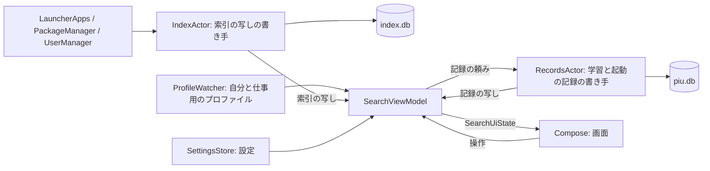

# 全体の構成

2026-11-14、R1〜R5・T7 の実装に合わせて更新（部品と流れ・状態の持ち主・保存の順序・画面・起動・プロファイルは 2026-11-23 に、索引の作成と更新・データの保存は 2026-11-24 に、記録と索引の書き手の形へ書き換え）。要件は [requirements.md](../requirements.md)、照合は [matching.md](matching.md)、学習は [learning.md](learning.md)、画面は [ui.md](ui.md)、テストは [testing.md](testing.md)。根拠にした API の挙動は [android-platform.md](../research/android-platform.md)。

## 範囲

扱うもの:

- 起動できるアプリ（ランチャーに並ぶ Activity。Activity は Android の画面 1 枚に当たる部品）の検索と起動。主プロファイルと仕事用プロファイルのアプリ
- 読み・表記ゆれ・英字のブランド名・ジャンル・学習による照合
- 呼び出し: ランチャーのアイコン、デジタルアシスタント、クイック設定タイル

扱わないもの: 連絡先・設定の項目・Web の検索、アプリのショートカットの起動（既定のホームアプリにしか許されない）、プライベートスペース（同）、ホーム画面の置き換え、ホーム画面のウィジェット。

## 部品と流れ

状態は 2 つの写し（索引・利用者の記録）に分け、それぞれ 1 本の書き手（actor）だけが差し替える。actor は、1 本の coroutine（Kotlin の軽い並行処理の単位）が頼みの列（`Channel`）から頼みを 1 つずつ処理し、ある状態の唯一の書き手になる作り。画面は流れてくる写し（`StateFlow`。最新の値を 1 つ持ち、購読した側に変化を配る流れ）を読むだけにする。

`SearchViewModel` は 4 つの流れ（索引・記録・プロファイル・設定）と、自分の持つ検索語・タブ・全アプリの表示から、画面に出すものすべて（`SearchUiState`）を作る。照合は `SearchEngine` が行い、派生の索引（学習を重ね、プロファイルで絞ったもの）は[画面の状態と派生の索引](#画面の状態と派生の索引)に記す。アプリを選ぶと `SessionTracker` が `LearningPolicy` で学習を判定し、記録の書き手に 1 つの頼みとして渡す（[起動](#起動)）。

## 状態の持ち主

`PiuApplication` がプロセスに 1 つの `AppContainer` を持ち、部品を手で組み立てる（依存の注入のライブラリは使わない）。2 つの書き手は、プロセスの起動時に作って読み込みを始める。検索画面を開かないプロセス（タイルやアプリ情報から設定だけを開いたなど）でも、消えたプロファイルの記録を整理するため。

| 持ち主 | 持つ状態 | 寿命・保存先 |
|---|---|---|
| `IndexActor`（data） | 索引の写し（組ごとの観測・材料・キー・最後の試み・ジャンル、プロファイルごとの一覧の状態）、まだ当てていないパッケージの知らせ、未保存の印、書き手の状態（同期中・最後の失敗・このプロセスの最後の同期の要約・最後に保存できた時刻） | プロセス。`index.db` |
| `RecordsActor`（data） | 読み込みの状態と記録の写し（学習と起動の記録）、終わっていないプロファイルの整理、救済の知らせと取り消し材料、記録の DB を作り直した印 | プロセス。`piu.db`（知らせと取り消し材料はメモリだけ。作り直した印はファイル） |
| `ProfileWatcher`（data） | 自分と仕事用のプロファイルの番号、仕事用が一時停止中か | プロセス。保存しない |
| `SettingsStore`（app） | 設定と初回の案内を閉じたか | SharedPreferences |
| `SearchViewModel`（app） | 検索語、タブ、全アプリの表示、セッション、派生の索引、起動中の印と知らせの保留 | ViewModel。回転で保つ。`SavedStateHandle` に保存するのは検索語だけ |
| `LearnedListViewModel`・`IndexStatusViewModel`（app） | 学習の一覧・索引の状態の画面の表示 | ViewModel |
| `AppContainer` の箱 | 前にアプリを開いたときの記録の保存の失敗（`openRecordFailed`）、学習の一覧の操作の結果（`ResultBox`）、検索画面が前面か | プロセス |
| `AppContainer` の解析器・アイコン | Kuromoji の辞書、アイコンのキャッシュ | プロセス。`onTrimMemory` で手放し、次に必要になったら読み直す |

Activity は描画と、OS の画面（アプリ情報・設定・アシスタントの設定）を開く操作だけを持つ。検索画面の `onStart`/`onStop` は前面の知らせを ViewModel に渡すだけで、ViewModel が索引の書き手の前面の印・記録の読み直し・忘却・プロファイルの読み直しを頼む。設定は流れで受けるので、`onResume` で読み直さない。

`LauncherApps.Callback` は `PackageWatcher` が、仕事用プロファイルの放送は `ProfileWatcher` が、アプリの寿命で受ける。放送の後は記録の整理を試し、検索画面が前面なら索引を同期する。

セッションの入力履歴は、アプリを選ぶ・構成の変更以外で画面を離れる・別の検索として呼び直すと捨てる。回転では捨てない。プロセスを作り直したときは現在の検索語だけを戻し、前の試行は復元しない。

アプリの寿命の scope（`AppContainer.appScope`。画面のスレッドで動き、プロセスが終わるまで取り消さない）で、画面が閉じても続ける仕事（受理した起動・学習のファイルの書き出しと読み込み・記録の頼みの結果の知らせ）を動かす。

## 保存の順序と書き手

各 DB を書くのは、その DB の書き手だけ。2 つの DB をまたぐトランザクションは使わない。書き手は頼みを届いた順に 1 つずつ処理し、処理の途中で中断（DB の書き込みを待つなど）しても次の頼みを始めない。

| 写し | 順序 | 理由 |
|---|---|---|
| 記録 | DB に書けたら写しを公開する | 記録は利用者の意思。画面に出したものが保存されていない状態を作らない |
| 索引 | 写しを公開してから DB に書く | 索引は消えてよい。保存を待たずに検索に使う。保存に失敗したら未保存の印を立て、次の機会に写しを丸ごと書き直す |

記録の書き手は、頼みのたびに次を 1 つの処理として行う。

1. その場で OS にプロファイルを問い合わせ、読めていなければ読み直す（読み込みの失敗を空の記録に置き換えない。空の写しから書くと保存済みの記録を上書きするため）
2. 写しから変更を計算し、1 つのトランザクションで `piu.db` に書く
3. 書けたときだけ写しを差し替えて流し、救済の知らせと取り消し材料を更新して結果を返す。書けなければ写しを変えずに失敗を返す

アプリを開いたときの学習と起動の記録は、1 つの頼み・1 つのトランザクションにする（片方だけが保存されることはない）。頼みは受け付けた時点で列に入り、頼んだ側が待つのをやめても最後まで処理する。

失敗の伝え方は操作によって異なる。

| 操作 | 表示 |
|---|---|
| 学習一覧の読み込み・削除・全消去・ファイル操作 | 一覧の Snackbar。ファイルを読めても、変更の保存が失敗したら成功とは知らせない |
| 検索画面での記録の読み込み・忘却・抑制・削除・取り消し | 失敗を Toast で知らせる |
| 索引の同期 | 最後の索引で検索を続ける。同期全体かプロファイルの失敗だけを検索画面に小さく出し、組の欠けは設定の「索引の状態」に出す（[知らせ](#知らせ)） |
| 起動の前の記録の保存 | 失敗しても起動する。「覚えた」の Toast は出さず、次に検索画面を開いたときに控えめに出す |
| 設定での起動記録の全消去 | 成功・失敗を Toast で知らせる |
| 記録の DB が壊れていた | 書き手が DB を消して新しく始め、検索画面で 1 回だけ知らせる（[ui.md](ui.md#記録の-db-を作り直したとき)） |

ログにはアプリの識別子・URI と、それらを含み得る例外のメッセージを出さず、操作と例外の型を残す。

## 画面の状態と派生の索引

`SearchViewModel` は入力の流れを画面のスレッドで受け、変化のたびに 1 か所で `SearchUiState` を作り直す。作り直すたびに学習のセッションへ「見えていた上位」を送るので、計算の回数とスレッドを決めておくため。索引の書き手の状態（同期の失敗など）だけの変化では照合をやり直さず、知らせだけを作り直す。

照合に使う索引は、索引の写しが変わるたびにアプリの寿命の側で 1 回だけ作る（`IndexSnapshot.toSearchIndex`、裏のスレッド）。派生の索引は、もとの索引（参照）・学習（中身）・自分と仕事用の番号・仕事用の扱いが変わったときだけ、1 本の裏のスレッドで作る。プロファイルや設定だけの変化では、学習を重ねた索引を再利用する。未開始の要求は最新の 1 件にまとめ（`mapLatest`）、完成した結果には入力を添え、画面のスレッドで採る直前に今の入力と比べて、違えば捨てる。

個人用の側は「自分のプロファイルの番号」で絞る（混ぜるときは仕事用も含む）。消えたプロファイルの組は次の同期まで索引に残るため、「仕事用を除く」では絞らない。さらに、派生の索引の完成を待つ間も、今のプロファイルと設定で出してよい番号を決め、結果の行・候補・すべてのアプリと起動の受付をすぐに絞る（消えたプロファイルや「出さない」にした仕事用のアプリを、完成の前から出さない・開かない）。

起動の記録だけが変わったときは、派生の索引を作り直さず、順位の信号と結果を更新する。

漢字の検索語の読みは、別の 1 本の裏のスレッドで付ける。前の読みの仕事を取り消して新しく始めるので、未開始の要求は走らない。実行中の Kuromoji の解析は止められないため、終わったときに検索語とセッションを確かめて古い結果を捨てる。読みは検索語だけの関数なので、当てるときは最新の索引・学習・タブ・表示で照合し直す。画面を離れると読みの仕事を取り消し、離れた後に派生の索引が完成しても、入力の記録や読みを再開しない。

照合・結果の整形・空検索の候補・全アプリの名前順の作成は画面のスレッドで行う（アプリ 500 個で照合は 0.2 ms ほど）。

## モジュール

Gradle（Android の標準のビルドツール）のモジュール（ビルドとテストの単位。依存の向きを明示できる）に分ける。種類の「JVM」は、Android に依存せず PC の Java の実行環境（JVM）でそのまま動き、テストできるもの。

| モジュール | 種類 | 中身 | 依存 |
|---|---|---|---|
| `core:text` | JVM | 正規化、かな・ローマ字の変換、英字の頭字語の読み | なし |
| `core:reading` | JVM | `ReadingAnalyzer`（読みを付ける部品の interface）と Kuromoji による実装 | `core:text`、Kuromoji |
| `core:search` | JVM | 索引のモデル、検索キーの生成、照合と順位付け、ジャンルの語彙、学習の規則 | `core:text`、`core:reading` |
| `core:state` | JVM | 索引の写しと同期の規則（plan・prepare・apply）、記録の写しと操作の規則 | `core:search` |
| `data` | Android ライブラリ | 端末の読み手（AppSource・GenreResolver など）、索引と記録の書き手（IndexActor・RecordsActor）と Room の DB、ProfileWatcher | `core:*` |
| `app` | Android アプリ | 画面（Jetpack Compose。画面を Kotlin の関数で組み立てる Android 標準の UI のライブラリ）、呼び出しの入口（Activity・TileService）、設定の保存、部品の組み立て | `data`、`core:*` |
| `release-test` | Android のテスト（`com.android.test`。配布物に入らない） | R8 を通した版（app の `benchmarkRelease`）を、アプリの外から UiAutomator と shell で試す計器テスト | `app`（試す相手） |
| `benchmark` | Android のテスト（`com.android.test`。配布物に入らない） | 起動の速さの計測（Macrobenchmark）と Baseline Profile の生成 | `app`（試す相手） |
| `test-apps:*` | Android アプリ（テスト専用） | 日本語の名前や `geo:` を持つ小さなアプリ。エミュレータに入れて索引とジャンルを確かめる | なし |
| `tools:dict` | JVM（配布物に入らない） | ブランド表などの辞書の検査と変換 | `core:text` |

分ける理由:

- 照合と学習を Android から切り離し、エミュレータなしで速くテストする
- モジュールの境界で依存を検査する。`core:*` から Android の API は呼べない

部品は `AppContainer` で組み立てる。依存の注入のライブラリは使わない。

解析器の差し替えの境界（#45）は、**今の結合を許す**。`core:search` は `ReadingAnalyzer` を使うが、依存先の `core:reading` には interface と Kuromoji の実装が同居する。さらに `AppContainer` は具体型を作り、索引のキーの生成（`GeneratorKeyFactory`）も Kuromoji の具体型を見て辞書を準備する。差し替えにはこれらの変更も要る。実装を別モジュールに分ける整理は行っていない。

## 索引の作成と更新

索引は「鍵つきのメモ化」で作る。メモ化は、計算の結果を「何から作ったか」の値（鍵）と一緒に覚え、同じ鍵なら計算し直さないこと。組ごとに、材料を読んだときの鍵とキーを作ったときの鍵を写しに持ち、今の端末と環境から作った鍵と違う組だけを読み直す。0.2.0 の同期のモード（変更番号による差分・全件の見直し・全件の作り直し）・作り直しの印・`meta` の言語と OS は持たない。これらの変化はすべて鍵に入り、読めなかった組は古い鍵のまま残って、読めるようになった同期で拾われるため。

同期の規則は `core:state` の `IndexRules`（Android に依存しない純粋な関数。同じ入力なら同じ出力を返し、外の状態を変えない）にあり、端末の読み取りは `data` の `DeviceReader`、キーの生成は `KeyFactory`、順序と保存は `IndexActor` が受け持つ。規則の性質（法則）は `IndexLawsTest`、具体例は `IndexRulesTest` で確かめる（[testing.md](testing.md)）。

### 用語

- **入口**: ランチャーに並ぶ Activity 1 つ
- **組**: プロファイル（のシリアル番号）とパッケージの対（`PackageKey`）。読み直し・欠けの記録・削除はこの単位で扱う
- **材料**: 組から読む、検索キーのもと。表示名（入口の一覧に付いてくる）・別の言語の名前・署名の証明書の主体の DN（提供元のキーのもと）
- **補助の材料**: 別の言語の名前と署名の DN
- **一覧の観測**（`PackageObservation`）: 同期のたびに入口の一覧から得る、組ごとの安い値。入口の集合（Activity 名の集合）・アーカイブ済みか・APK の鍵・更新の時刻
- **APK の鍵**（`apkKey`）: base と split の APK のパス・時刻・大きさを並べた文字列。内容のハッシュではない。作れなければなし（失敗ではない）
- **更新の時刻**（`updatedAt`）: 個人用は `PackageInfo.lastUpdateTime`、仕事用は base の APK のファイルの時刻。取れなければなし
- **材料の鍵**（`MaterialKey`）: 一覧の観測の 4 つと、言語・OS のビルド・読み取りの部品の版（`readerVersion`）
- **キーの鍵**（`DerivedKey`）: キーの生成の規則の版（`SearchIndexVersion`。辞書・正規化・読みの補いを変えたら上げる）と、ブランド表の中身から作る値
- **検索に使う値**（`Current`）: 材料とキーと、それを作ったときの 2 つの鍵。材料の読み取りとキーの生成がすべて成功した回の結果だけが入る
- **最後の試み**（`Attempt`）: 最後に試したときの 2 つの鍵・再起動の回数・欠け・再試行の枠。次に読み直すかは、検索に使う値の鍵ではなくこちらの鍵で決める
- **代わりの表示名**（`substitutes`）: 検索に使う値を持たない入口の表示名。キーは表示名に NFKC と正規化だけをかけたもの（読みの生成を通さない）
- **段**: 組の読み取りとキーの生成の区切り。`ENTRY`・`LABEL`・`SIGNER`・`KEYS` の 4 つ（[材料の欠け](#材料の欠け)）
- **欠け**: 組の最後の試みの本当の失敗（組ごとに 1 つ）。「索引の状態」にはこれを出す
- **知らせ**: `LauncherApps.Callback`（OS がパッケージの追加・更新・削除をこのアプリに知らせる仕組み）の 1 件

### 更新のきっかけ

`PackageWatcher` がアプリの寿命で `LauncherApps.Callback` を登録し、知らせを索引の書き手に渡す。同じ知らせでアイコンのキャッシュも失効させる。書き手は知らせを溜め、検索画面が前面のときだけ同期する。前面になったら、知らせの有無によらず同期する（プロセスがない間の変更を一覧の観測で拾うため）。続けて届いた頼みは 1 回の同期にまとめる。設定・学習の一覧・索引の状態の画面は、開くたびに同期を頼む。

検索開始時の記録の読み直しと学習の忘却は `SearchViewModel` が頼む。プロファイルの放送は `ProfileWatcher` が受ける。

### このアプリを更新したとき

キーの作り方（`SearchIndexVersion`）や索引の形が変わる版では、更新の後の最初の同期が全件の作り直しになる（0.2.0 から 0.3.0 への更新では実機で数秒かかり、その間は検索の結果が出なかった）。そこで、利用者が開く前に同期を始める。

1. OS は更新を終えると、更新したアプリにだけ `ACTION_MY_PACKAGE_REPLACED` を送る。`PackageReplacedReceiver` がこれを受ける。受け手のためにプロセスが起きると `AppContainer` ができ、記録の書き手が読み込みと記録の DB の移行を、索引の書き手が `index.db` の読み戻しを始める
2. 受け手は JobScheduler（OS が条件と資源を見て、預かった仕事をあとで動かす仕組み）に、決まった番号の仕事を 1 つ預けるだけにする。受け手の持ち時間（約 10 秒）の中で同期を終える保証はないため。同じ番号で預け直すと前の仕事を置き換えるので、待つ仕事は常に 1 つ。Android 12 以上では急ぎの仕事（expedited）にする。ふつうの仕事は、OS が資源の都合で後へずらしうるため。急ぎの枠を使い切って断られたら、ふつうの仕事で預け直す。Android 9 は条件のない仕事を作れないので、待ち時間 0 を条件にする
3. `IndexRebuildJob` は索引の書き手に同期を頼み、その同期の写しを公開して保存を試したら `jobFinished` を呼ぶ（再試行は頼まない）。同期そのものは[同期の実行と保存](#同期の実行と保存)のとおりで、ログ `PiuIndexSync` に件数と時間が出る
4. OS に止められたら（`onStopJob`）待つのをやめ、預け直さない。書き手の同期はそのまま続くことがある。終わらずにプロセスが終わっても、次に開いたときの同期が、最後に保存できた写しから鍵の違う組だけを読む（保存の前に終わったなら、作り直しは最初から）

新しく入れたときは何もしない。この放送は来ず、入れたばかりのアプリは利用者が開くまで停止状態で、コードを動かせないため。利用者が強制停止した後（停止状態）に更新したときも、この放送は届かない（エミュレータの API 28 と 37 で確かめた）。どちらも、開いたときの同期で作り直す。画面が開いている間に仕事が動いても、書き手は続けて届いた頼みを 1 回の同期にまとめ、同期の途中に届いた頼みは続く 1 回にまとめるので、余分に読まない。WorkManager は使わない（JobScheduler で足り、依存を増やさない）。

### 何を読み直すか

入口の列挙では、OS が合成した「アプリ情報」への入口を除く。AOSP の `LauncherAppsService.getHiddenAppActivityInfo` は対象パッケージに `android.app.AppDetailsActivity` を付けて返すため、クラス名の完全一致で見分ける。アプリを起動する入口ではないため索引に入れない。同じ末尾を持つ通常の Activity（`対象パッケージ.AppDetailsActivity` など）は除かない。

根拠は AOSP android14-release の [LauncherAppsService](https://github.com/aosp-mirror/platform_frameworks_base/blob/android14-release/services/core/java/com/android/server/pm/LauncherAppsService.java#L467) と [PackageManager の合成用クラス名](https://github.com/aosp-mirror/platform_frameworks_base/blob/android14-release/core/java/android/content/pm/PackageManager.java#L4933)（2026-11-14 確認）。公開 API に合成の印はないため AOSP のクラス名を使う。独自のクラス名に変えた OS は未確認。

同期のたびに、すべてのプロファイルの入口の一覧を取り、組ごとに一覧の観測を作る。更新の時刻は個人用の組でも毎回引く（変更番号は使わない）。アーカイブ済みかは一覧の `LauncherActivityInfo.getApplicationInfo()` の `isArchived` から読む（[アーカイブ済みのアプリ](#失敗の分け方)）。一覧が最後まで読めたプロファイル（`COMPLETE`）の組について、`IndexRules.plan` が次を決める。

| 対象 | 条件（どれか 1 つ） |
|---|---|
| 材料を読み、キーも作り直す | 写しにない／最後の試みの材料の鍵が今の材料の鍵と違う／組への知らせがある／再試行の枠が立っている／欠けがあり、欠けを書いた版が今のこのアプリの版と違う／欠けがあり、最後の試みのキーの鍵が今と違う／鍵のない組（APK の鍵も更新の時刻もない）で、再起動の回数が取れて、最後に試したときの回数と違う |
| キーだけを作り直す | 上のどれにも当たらず、最後の試みのキーの鍵が今と違う（生成器の版かブランド表が変わった）。材料は検索に使う値のものを使う |
| 写しから消す | 一覧が最後まで読めたプロファイルにない組／存在しないと確かめたプロファイル（[削除の確認](#削除の確認)）の組 |
| ジャンルを問い合わせる | 一覧の全入口。APK の変更によらず毎回 |

ジャンルは原則として規則ごとに全体を問い合わせる。ブラウザの https 問い合わせには `MATCH_ALL` を付け、既定以外も含める。カメラだけは入口を持つパッケージの重複を除き、`setPackage` して 1 パッケージにつき 1 回問う。この分の問い合わせ数はパッケージ数に比例する。APK が変わらないジャンルの変化にも追従する。ジャンルは名前のキーと別に持ち、ジャンルだけが変わっても材料は読まず、形態素解析もしない。仕事用の intent の情報には制限がある（[matching.md](matching.md#intent-filter-とカテゴリによるジャンル)）。

アーカイブ済みの組は補助の材料を読まない（[失敗の分け方](#失敗の分け方)）。

#### 鍵の比べ方

APK の鍵と更新の時刻は、変化を見つけるための値で、材料ではない。**鍵が作れないことは失敗にしない。** 検出が粗くなるだけにする。材料の鍵は成分ごとに等しいかで比べるので、前回と今回の片方だけに値があれば「変わった」、両方ともなければ「変わっていない」になる。

比べる相手は最後の試みの鍵で、検索に使う値の鍵ではない。読み取りが失敗しても最後の試みの鍵は今の値になるので、同じ鍵のままなら次の同期で読み直さない（失敗し続ける組を毎回読み直さない）。

鍵は 1 つの組で 3 回観測しうる: 一覧の時点・材料を読む前・読んだ後。最後の試みに書くのは一覧の時点の値だけで、読む前後の値は一覧の値と一致するかを確かめるためだけに使う。どちらかが一覧の値と違えば、読んでいる間に APK が替わったとして `ENTRY` の `CHANGED_DURING_READ`（一時的）にする（段の失敗より先に判定する。替わった APK の決定的な失敗を確定せず、再試行するため）。一覧の時点で値がない成分は比べない（片方がない比較では、替わったかを決められないため）。

APK の鍵に大きさを入れるのは、時刻が 0 に固定されるファイル（APEX の中の APK。AOSP の `apexer` が時刻を 0 にして画像を作る）でも、版が替われば大きさは変わる見込みが高いため。時刻は失敗を例外で知らせる NIO（`Files.readAttributes`）で読み、0 を有効な値として扱う。`File.lastModified()` は失敗も 0 で返すので使わない。

**鍵のない組**（APK の属性が読めない仕事用の組など）は、変化を鍵で拾えない。再起動の回数（`Settings.Global.BOOT_COUNT`）を最後の試みに持ち、今の回数と違えば 1 回読み直す（起動 1 回につき 1 回）。回数が取れない端末では読み直さず、プロセスがない間の更新の取りこぼしは知らせ・入口の集合とアーカイブの変化・言語と OS の変更に頼る。個人用の組は更新の時刻を必ず持つので、ここに当たらない。

APK の鍵は内容のハッシュではない。同じパス・時刻・大きさのままの入れ替えや資源オーバーレイのすべては検出できないため、知らせ・毎回のジャンルの判定・OS と言語による作り直しを併用する。

### 材料の欠け

**組ごとに全部か無か。** 材料の読み取りとキーの生成がすべて成功した組だけ、検索に使う値を丸ごと置き換える。本当の失敗が 1 つでもあれば、その組の検索に使う値は前のまま丸ごと保ち（材料・キー・由来の鍵）、最後の試みにだけ今の鍵と欠けを書く。段ごとに読めた分だけを採ると、欠けた段の古い材料と新しい材料が混ざる組み合わせが増え、穴が続いたため。失うのは、一部の材料だけ失敗した回に、読めた部分の更新が次に成功する回まで反映されないこと。

**ないことが決まっているものは、成功した空。** 次は失敗にせず、空の値で読めたとする（欠けにしない。「索引の状態」にも出さない）。

- その言語に名前の資源がない（`Resources.NotFoundException`。既定の `values/` になく `values-ja/` だけにある名前など）
- 表示名が資源でない（マニフェストに直に書いた）・split がない・署名の履歴がない
- 署名が空（`NO_SIGNERS`）
- アーカイブ済み（補助の材料を読まない）
- API 30 以下で、仕事用にしかないアプリの別の言語の名前（`NameNotFoundException`）。API 30 以下の `LocalizedLabelReader` は自分のプロファイルで `createPackageContext` するため、読めないことが決まっている。自分のプロファイルから見えないと確かめられたときだけで、見える・確かめられないなら一時的な失敗のまま

段は、どこで欠けたかを表す。

| 段 | 読むもの |
|---|---|
| `ENTRY` | 組全体の詳細（一覧の表示名、入口の変換、一覧との突き合わせ、読み取りの前後の鍵の比較） |
| `LABEL` | 別の言語の名前 |
| `SIGNER` | 署名の DN |
| `KEYS` | 検索キーの生成（このアプリの処理） |

材料の段の失敗は、段の順（`ENTRY`・`LABEL`・`SIGNER`）で最初のものを組の欠けにする。材料が読めても、キーの生成が 1 つの入口で失敗すれば `KEYS` の欠けにし、読めた材料も採らない。

**一覧にある入口は、必ずそのとおりに索引に入れる。** 組の入口の集合は、成否によらず今回の一覧の入口の集合にする（`IndexLawsTest` の法則 2）。

| 入口 | 失敗した回の扱い |
|---|---|
| 検索に使う値にある | 前のキーを保つ |
| 検索に使う値にない（新しい入口・一度も成功していない組） | 代わりの表示名で出す。その回に一覧から取れた表示名、なければ一覧に残り続けた入口の前の代わりの表示名、それもなければパッケージ名 |
| 一覧から消えた | 検索に使う値からも落とす（消えた入口が後で戻ったとき、前の APK の提供元などのキーを戻さないため） |

代わりのキーの生成まで例外になったら、キー 0 個で入れる（入口があれば読み直しは止まる）。表示名は、読む組の入口についてだけ一覧の `LauncherActivityInfo.getLabel()` から取る（全件で取ると、毎回すべてのアプリの資源を開くため）。

欠け（`Issue`）は組ごとに 1 つで、段・失敗（理由・区分・フレーム・入力の要約）・失敗した試みのこのアプリの `versionCode`・続けて欠けている間の初めの日と最後の日（UTC の `YYYY-MM-DD`）を持つ。区分は読み手が理由から決めて渡し、写しに保存する。日は表示と報告のためだけに持ち、判断には使わない（端末の時計は利用者が変えられるため）。

| 区分 | 意味 | 読み直す時機 |
|---|---|---|
| 一時的 | 読み直せば直る見込みがある | 通常のきっかけに加えて、1 回だけ（再試行の枠） |
| 決定的 | 材料（APK・OS・言語）が替わるまで同じ結果になる | 通常のきっかけと、このアプリの版の変更 |
| 不具合の疑い | このアプリ側の例外 | 同上 |

#### 読み直しの規則

組を読み直すのは、[何を読み直すか](#何を読み直すか)の条件に当たったときだけ。欠けがあるだけでは読み直さない。

- **再試行の枠**は組に 1 つ。一時的な失敗で立て、次の同期で組を 1 回だけ作り直す。再試行だけがきっかけの回に失敗したら立てない（枠を使い切る）。鍵の変化・知らせ・版の変更などのきっかけと重なった回は、その変化への 1 回目の試みなので、また一時的に失敗すれば立て直す。回数の列と上限の定数は持たない。時間による再試行（1 日に 1 回など）は入れない。決定的な失敗には効かず、一時的な失敗は 1 回で足りる
- **このアプリの版**が欠けを書いた版と違えば、欠けのある組を材料から読み直す（`KEYS` だけの欠けでも。キーだけを作り直す経路を持つと規則が増え、版の更新はまれなため）。読めないプロファイルの組は前の写しのまま残り、欠けの版も古いまま残るので、読めるようになった同期で読み直す。不具合を直した版を配れば、利用者が何もしなくても読み直される
- 試みのたびに欠けを書き直すので、例外が起きた版と確かめた版は同じ値になる
- **知らせ**は、その組を作り直した回か、不在を確かめた回（一覧が最後まで読めて組がない・プロファイルが消えた）に当てたことになり、当てた写しを保存できたら消す（[同期の実行と保存](#同期の実行と保存)）。成否によらず当てたことにする。読み直しは欠けと再試行の枠が受け持ち、失敗した知らせを残すと、決定的な欠けの組を毎回読み直すため。通知元のシリアル番号が分からない知らせと、読めないプロファイルの組の知らせは残し、次の同期で当てる

#### 失敗の分け方

catch を置くときは、次の 3 つを決めて、コメントに理由を書く。

1. **失敗の単位はどこか。** 同期全体・プロファイル 1 つ・組 1 つ・段 1 つ。catch はその境界にだけ置き、境界の内側で捕まえて空にしない。1 つの組の失敗でほかの組を止めない。逆に、このアプリの不具合を 1 つの組の欠けに丸めない
2. **読み直せば直る見込みがあるか。** 例外の型で分ける（下の表）。型で決められない例外は不具合の疑いとし、型を残す。黙って「不完全」にしない
3. **正常な不在と区別できるか。** ないことが決まっているもの（[材料の欠け](#材料の欠け)の「成功した空」）は失敗ではない。区別できないものは失敗として扱う（正常な空として保存しない）

| 例外・結果 | 区分 | 理由 |
|---|---|---|
| `PackageManager.NameNotFoundException` | 一時的 | 一覧を取った後に消えた。次の一覧で組が消える |
| 一覧にあった入口が詳細にない（`VANISHED`） | 一時的 | 同上。競合かもしれず、削除とは決めない |
| 読み取りの前後で鍵が一覧と違う（`CHANGED_DURING_READ`） | 一時的 | 読んでいる間に APK が替わった。鍵も変わるので、次の同期で読み直す |
| `RemoteException`（`DeadObjectException` など）。`RuntimeException` の原因（cause）の連鎖にあるときも | 一時的 | OS のサービスとの通信の失敗。PackageManager は `RemoteException` を `RuntimeException` に包んで投げる。連鎖にあれば、その `RemoteException` を分類と理由に使う（下記） |
| `IOException` | 一時的 | 理由が多様。1 回読み直してまた欠ければ、次の通常のきっかけまで待つ |
| `CertificateException` | 決定的 | 証明書は APK が替わるまで同じ |
| `getPackageArchiveInfo` が null（`ARCHIVE_UNREADABLE`） | 決定的 | APK を解釈できない。APK が替わるまで同じ |
| `SecurityException` | 決定的 | 権限の問題で、OS が替わるまで同じ。OS の変更と版の変更で読み直す |
| キー生成の例外。形態素解析の辞書の初期化の `RuntimeException` も | 不具合の疑い（`KEYS`） | 自分の処理の不具合。初期化の失敗は同期全体を止めず、その回にキーを作る入口すべてを、その例外の `KEYS` の失敗にする（キーの生成には進まない。入口ごとに辞書の読み込みを試し直すため）。入力の要約は `unknown` |
| その他の `RuntimeException`・`Exception` | 不具合の疑い | 型で決められない。型を残す |
| `Error`（メモリ不足など） | 捕まえない | 続けて動かせる状態ではない |

`Resources.NotFoundException` と `NO_SIGNERS` は、区分の表では決定的だが、読み手が成功した空に変えるので欠けにはならない。

読み取りの前後の鍵の比較（`CHANGED_DURING_READ`）は、個人用でも行う。読んでいる最中の更新で資源が開けず、決定的な例外が出た場合に、それを一時的な失敗として扱い直せるのはこの比較だけのため。

**アーカイブ済みのアプリ。** Android 15（API 35）から、アプリを「アーカイブ」できる。APK とキャッシュを消し、利用者のデータを残す状態で、`LauncherApps` は引き続きそのアプリの入口を返す。Google Play はストレージが足りないとき、使っていないアプリを自動でアーカイブする。`ApplicationInfo.isArchived`（`PackageItemInfo` のフィールド。API 35 で追加。[公式のリファレンス](https://developer.android.com/reference/android/content/pm/PackageItemInfo#isArchived)と [Android 15 の機能の一覧](https://developer.android.com/about/versions/15/features)で 2026-11-15 確認）を、一覧の `LauncherActivityInfo.getApplicationInfo()` から毎回読み、一覧の観測に入れる。一覧の `ApplicationInfo` でアーカイブ済みのアプリの値が真になることは、API 37 のエミュレータで確かめた（2026-11-15。test-apps のアプリを `pm set-installer <パッケージ> com.android.shell` の後に `pm archive` し、`LauncherApps.getActivityList` が入口を返し続け、その `ApplicationInfo` の `isArchived` が真、`sourceDir` が null。インストーラのないアプリは `pm archive` が「No installer found」で拒む。`ArchivedAppInstrumentedTest`）。API 34 以下では常に偽。

- アーカイブ済みの組は補助の材料を読まず、空で成功とする。表示名とキーは通常どおり作る。APK がないので APK の鍵もない（失敗ではない）
- アーカイブ済みかは材料の鍵に入るので、アーカイブしたとき・復元（unarchive）したときに必ず読み直す
- 件数は写しの一覧の観測から数え、報告用の文には件数だけを出す。欠けとして扱うと、ストレージの逼迫した端末ほど「索引の状態」がアーカイブしただけのアプリで埋まり、報告に使えなくなる

アーカイブ済みのアプリを開くと OS がインストーラに復元を頼むが、Piu Search はそれも「開いた」と数える。

**理由（`cause`）の書き方。** 例外なら、分類に使う例外を決め、そのクラスから親をたどって、名前が `java.`・`android.` で始まる最寄りのクラスの名前（`Class.getName()`）を入れる。例外でない結果は固定の符号（`VANISHED` など）を入れる。どの段で起きたかは欠けの段が持つ。

- 分類に使う例外は、捕まえた例外そのもの。ただし原因の連鎖に `RemoteException` があれば、その `RemoteException`
- 区分は、理由の名前を `Class.forName` で読み込み、親をたどって上の表の型に当てる関数（`MaterialCauses.categoryOf`）で引く。`java.`・`android.` のクラスは端末にあるので読み込める。読み込めない名前は不具合の疑いにする
- `java.`・`android.` に限るのは、名前が R8 で変わらないため。R8（release の組み立てでコードを縮め、名前を短く替える道具）は、このアプリのクラスだけでなく、APK に入るライブラリ（Kuromoji・Room・Kotlin の標準ライブラリ）のクラスの名前も替える。JDK と Android のフレームワークのクラスは APK に入らないので名前が変わらない。Kotlin の例外（`UninitializedPropertyAccessException` など）も `java.lang` の例外の子なので、`java.` の親が理由になる
- 例外のメッセージは、パスや識別子を含みうるので保存しない

**不具合の疑いの欠けには、例外の先頭 5 フレーム**（クラス・メソッド・ファイル・行の番号。メッセージは入れない）と、失敗した試みの Piu Search の `versionCode` を残す。型だけでは、メンテナが再現できないため。このアプリとライブラリのフレームは R8 で名前が変わっているので、メンテナがその版の `mapping.txt`（R8 の名前の対応表。[release.md](../release.md)）で戻す。行の番号を残すため、app の `proguard-rules.pro` に `-keepattributes LineNumberTable,SourceFile` と `-renamesourcefileattribute SourceFile` を書く。前者で行の番号とファイル名の属性を残し、後者でファイル名を一律に `SourceFile` に替える（元のファイル名を APK に残さない。`mapping.txt` で戻せる）。

`KEYS` の不具合の疑いには、例外が起きた入力の要約を残す。入力の種類（表示名・別の言語の名前・提供元の DN・パッケージ名）と、その長さと文字種（漢字・かな・英数字・絵文字・その他のどれを含むか）。文字列そのものは残さない（例: `label:len42:kanji,kana`）。失敗したときに書き、報告のときに今の索引から作り直さない（前の値を保った組では、索引の表示名は失敗したときの入力と違うため）。

### プロファイルと同期全体の失敗

プロファイルごとに `COMPLETE`（全部読めた）・`UNAVAILABLE`（一時停止やロックで今は読めない）・`FAILED`（一覧か状態の問い合わせが例外になった）を分け、写しにプロファイルごとの最後の一覧の状態として持つ。**更新と、一覧にないことによる削除は、一覧と材料の両方が有効なプロファイルにだけ当てる。** 材料を読み終えた後に読めなくなったプロファイル（読み手が確かめ直す）も当てない。ほかのプロファイルの組は前の写しのまま保つ（`IndexLawsTest` の法則 3）。鍵が古いまま残るので、読めるようになった同期で、言語・OS・このアプリの版の変化も含めて拾われる。一時停止は失敗に数えない（検索画面には一時停止の知らせを別に出す）。

同期全体の失敗は、同期 1 回が例外で終わったこと（一覧の観測の例外など）。写しと知らせは前のまま保ち、書き手の状態の `syncFailure` に理由を出し、次の頼みで最初からやり直す。ジャンルの問い合わせの失敗は同期 1 回の単位で、既存のジャンルを保ち、`genreFailure` に出す。

### 知らせ

利用者への知らせは、出す条件と消す条件を対にして決める。検索画面に出すのは、**アプリが検索に出ないか、古いままになる失敗**だけ。

| どこに | 知らせ | 出す | 消す |
|---|---|---|---|
| 検索画面 | 同期全体の失敗 | 同期が例外で終わった | 次の同期が最後まで終わった |
| 検索画面 | プロファイルの失敗 | このプロセスで同期が終わった後、あるプロファイルの一覧の状態が `FAILED` | 次に終わった同期で、そのプロファイルが `FAILED` でない（読めた・一時停止中・消えた） |
| 設定の「索引の状態」 | 材料の欠け（組ごと） | 最後の試みに欠けがある | 次の試みが成功した・組やプロファイルが消えた |
| 設定の「索引の状態」 | ジャンルの判定の失敗 | 最後に終わった同期で、問い合わせが例外になった | 次の同期で問い合わせが成功した |

- 組の欠けとジャンルの失敗は検索画面に出さない。一時的な欠けは自動で 1 回読み直され、決定的な欠けは利用者に打つ手がない。ジャンルは失敗しても前のキーを保つ。どれも、常に見られる設定の「索引の状態」に置き、報告の材料をコピーできるようにする（[ui.md](ui.md#索引の状態)）
- 検索画面の 2 つは、失敗が続く限り出し続ける。どちらも「検索に出ない・古いまま」が続いていることを表すので、出し続けるのが実態に合う。決定的な組の欠けはここに入らないので、「成功が来ないまま出続ける知らせ」にはならない
- プロファイルの失敗は、このプロセスで同期が終わってからだけ見る。写しの一覧の状態は保存されていて、前のプロセスの結果を含むため
- 設定の「仕事用プロファイルのアプリ」が「出さない」なら、仕事用のプロファイルの失敗は検索画面に出さず、「索引の状態」にだけ出す。利用者は仕事用を検索しないので、検索画面では雑音になる
- ログ（`PiuIndexSync`）には、識別子を出さずに件数と時間だけを残す。組の識別子は、端末の中の写しにだけ置く

最後の同期の結果は、次の 4 つのうち上から最初に当てはまるもの。「索引の状態」の概要と報告用の文の `last sync` に使う（[ui.md](ui.md#索引の状態)）。

| 結果 | 条件 | 意味 |
|---|---|---|
| `FAILED` | 同期全体の失敗 | 何も更新できなかった |
| `PARTIAL` | あるプロファイルが `FAILED`、またはジャンルの判定が失敗した | 一部を古いまま残した |
| `ISSUES` | 同期の後に欠けがある（読めないプロファイルの保った組を含む） | 更新できたが、読めていない情報がある |
| `OK` | 上のどれでもない | 更新できた |

一時停止中（`UNAVAILABLE`）のプロファイルは、結果を下げない。一時停止は失敗ではなく、別の知らせで出すため。「仕事用プロファイルのアプリ」の設定も結果を変えない（設定で変わるのは検索画面に出すかどうかだけ）。

### 同期の実行と保存

`IndexActor` は、作った時点で `index.db` から写しを読み戻して公開し（読めなければ空から始め、ファイルは消さない）、頼み（同期・知らせ・前面の印・保存の再試行）を届いた順に 1 つずつ処理する。続けて届いている頼みは先に受け、同期を 1 回にまとめる（知らせの対象は落とさない）。端末の読み取り・キーの生成・保存はすべてこの列の中で行い、その間に写しはほかから変わらない（書き手が 1 つなので、0.2.0 の写しの世代の照合・前提の再確認・計算のやり直しは要らない）。

同期 1 回の順序:

1. 環境（言語・OS のビルド・再起動の回数）と一覧を観測し、写しにあるプロファイルと今回の一覧に現れたプロファイルのうち、存在しないと確かめたものを得る（一覧が古いまま削除したプロファイルを返しても、写しに戻さないため）
2. `IndexRules.plan`: 前の写し・観測・環境・まだ当てていない知らせから、材料を読む組・キーだけを作る組・消す組を決める
3. 端末から材料を読む（プロファイルごと・組ごとに成否を返す）
4. `IndexRules.prepare`: 読んだ結果を受け、キーを作る入口を決める。失敗した組の入口は頼まない
5. キーを作り、ジャンルを問い合わせる
6. `IndexRules.apply`: 次の写しを作る。作り直そうとした組と消した組は、アイコンの失効のために流す（写しが前と同じ回でも流す）
7. 写しを公開してから `index.db` に書く（索引は消えてよいので、保存を待たずに検索に使う）

**未保存の印。** 公開した写しが最後に保存できた写しと違えば印を立て、保存を始める前に書き手の状態にも出す（`unsaved`）。保存は写しを丸ごと 1 つのトランザクションで書き、成功したときだけ印を下ろす。差分にしないのは、失敗した回の変更を取りこぼさないため。失敗したら印を立てたまま、次の機会（次の同期・前面への復帰・`retrySave`）に今の写しを書き直す。

- 保存の失敗は、材料を読み直す理由にならない。`retrySave` は写しを書き直すだけで、端末を観測しない。次の同期は、公開した写しの最後の試みの鍵と比べて[何を読み直すか](#何を読み直すか)の規則どおりに読む（その回に一時的な失敗があれば、再試行の枠でその組を読む）
- 未保存の印と知らせは、プロセスの中だけの状態で、保存しない。保存できないままプロセスが終わると、次のプロセスは最後に保存できた写しを読み戻し、端末を観測し直す。一覧の観測（入口の集合・アーカイブ・APK の鍵・更新の時刻）の変化はそこで拾えるが、鍵の変わらない変化で知らせだけが知っていたものは取りこぼしうる

**知らせの持ち方。** 知らせはプロセスの中で、（通知元の `UserHandle`・パッケージ名・届いた順の番号）で持ち、受けた時点でシリアル番号が分かれば一緒に持つ。分からなければ同期のときに通知元から解決し、解決できなければ残す。届いた知らせは「まだ当てていない」に入れ、それを当てた写しを公開したら「保存待ち」に移し、その写しを保存できたら消す（同じプロセスの中で、保存に失敗した回の知らせを次の保存まで残すため）。同期の途中に届いた知らせは、その同期の後に列から取り出すので、その同期では消えない。知らせで同期するかは、同期を始める直前の前面の状態で決め、前面なら続く同期を 1 回起こし、裏なら溜めるだけにする。

**書き手の状態**（`IndexStatus`）: 読み戻したか・読み戻しの失敗・同期中か・同期全体の失敗・ジャンルの失敗・未保存か・最後に保存できた時刻（`index.db` に写しと一緒に書くので、プロセスを起動し直した後でも出せる）・このプロセスの最後の同期の要約（終えた時刻・時間・材料を読んだ組の数・キーを作った組の数・消した組の数・失敗したか）。最後の同期の要約は、同期のたびに `PiuIndexSync` のログにも件数と時間だけを出す（release-test と計測が読む）。

同じ DB の書き手は同時に 1 つしか作れない（`IndexActor.open` が拒む）。製品の `open` は `index.db` に固定し、ファイルの名前を受けない。索引の DB は形が変われば中身を捨てるので、記録の DB（`piu.db`）を取り違えて開くと記録が消えるため。

### 辞書とアイコン

Kuromoji の辞書は、作り直す入口があるときか漢字の検索語が来たときに、裏のスレッドで準備する。同期での準備が失敗したら、その回にキーを作る入口を `KEYS` の欠けにする（[失敗の分け方](#失敗の分け方)）。読みには NFKC だけをかけた文字列を渡す。厳密形では辞書の表記と合わず、区切りが崩れるため。M1-02 の JVM（JDK 21）の測定では、初期化は約 170 ms、ヒープは 41 MB。辞書は APK を約 13 MB 大きくする。

アイコンは Room に入れず、表示時に別のスレッドで読み、メモリに置く。Callback と同期で検出した変更はパッケージ単位で失効させ、表示中の行にも世代の変化を伝える。読み込み中に失効した古い画像はキャッシュへ戻さない。

長い表示名の読みの生成は同期を遅くする（5,000 字で JVM 上で約 1 秒、M5-03）。字数の上限は設けていない。

## 起動

選んだ時点で表示名・時刻・学習の判断を固定してセッションを終え、起動中の印を ViewModel に立てる。押した行が学習のキーで出ていれば、当たった元の学習の組（前方一致・ローマ字で当たった語）を判断に入れる。学習と起動の記録を 1 つの頼みとして記録の書き手に渡し、その結果を待ってから `LauncherApps.startMainActivity` を呼ぶ。保存の成功と OS の受付の後にだけ救済の Toast を出す。保存失敗でもアプリは開く。受理した起動（保存と OS への要求）はアプリの寿命の scope で最後まで行い、画面が閉じても続ける。

一時停止中の仕事用アプリは、OS の再開確認に渡すだけなので起動回数にも学習にも数えない（一時停止かは選んだ時点で決める）。起動先の `UserHandle` は、OS に渡す直前に固定したシリアル番号から引き直す。通常の要求は OS に拒まれても保存済みの記録を巻き戻さない。起動回数は「開くために選んだ要求」の数で、表示成功の回数ではない。

OS の受付後は、起動を受け付けた画面だけを閉じる。ViewModel は閉じる画面の札（Activity が作る印。作り直した画面は別の札）を流し、Activity は作ってから壊すまで購読して、自分の札なら閉じる。呼び直しの後の画面は起動の切符の照合で、回転の後の画面は札の照合で、古い完了で閉じない。閉じかけ・壊れかけの画面への操作は Activity が受けない。起動中の印は成否によらず解き、今回の知らせを次の検索まで保留する印とは分ける。失敗後のセッションの再開は、画面が表示中か復帰したときだけ行う。詳しくは [learning.md](learning.md#アプリを開くときの保存r22026-11-14)。

## プロファイル

アプリの入口は `LauncherApps.getProfiles()` で主プロファイル（個人用）と同じグループのプロファイルから集める。検索の対象は画面と設定で選ぶ（[ui.md](ui.md#仕事用プロファイル)）。プライベートスペースや別のユーザーのアプリは扱わない。`ProfileWatcher` は、自分以外の `getProfiles()` を仕事用とみなし、`isQuietModeEnabled` で一時停止を見る。問い合わせが失敗したら前の値を保つ。

保存には `UserManager.getSerialNumberForUser` のシリアル番号を使う。削除後に作ったユーザーには同じ番号が付かないため、新しい仕事用に古い学習を取り違えない。

### 削除の確認

記録の書き手は、最初の読み込み・頼みのたび・前面への復帰・プロファイルの放送で、`UserManager.getUserProfiles()` に問い合わせる（一時停止中も存在の一覧に含まれる）。索引の書き手は同期のたびに同じ問い合わせをする。

自分のユーザーを含まない一覧、番号が取れない一覧、問い合わせの例外では何も消さない。**削除と決めるのは、有効な一覧で存在しないと確認できたときだけ**。LauncherApps に見えない・一時停止中・ロック中というだけでは消さない。

### 削除の保存と遅い書き込み

記録の書き手は、今ないと確かめた番号への書き込み（遅い記録・抑制・ファイルの読み込み・古い取り消し）を拒み、その番号の学習と起動の記録を消す整理を 1 つのトランザクションで行う。整理を待つ記録は、整理が終わる前から画面に出す写しに含めない。整理に失敗したら対象を残し、次の頼みと前面への復帰で再試行する（同じ集合の知らせだけに頼ると、再試行の機会がないため）。削除したプロファイルの番号は覚えない。問い合わせに失敗した回の書き込みは受け、次に存在を確かめた回の整理で消す。

索引の書き手は、存在しないと確かめたプロファイルの組を次の同期で写しから落とす。画面はそれを待たずに、[絞り方](#画面の状態と派生の索引)で隠す。

存在の一覧とシリアル番号の契約は [UserManager の公式リファレンス](https://developer.android.com/reference/android/os/UserManager#getUserProfiles()) による（2026-11-14 確認）。存在の照合と、アプリを起動・読み取りできるかの判定は分ける。

## データの保存

Room（AndroidX の SQLite のライブラリ。表の定義と問い合わせを Kotlin で書け、コンパイル時に検査される）で 2 つのデータベースを持つ。

| DB | 中身 | 消えてよいか | 形が変わったら |
|---|---|---|---|
| `piu.db`（Room の版 7） | `learned`・`launch_stat`・`installation` | よくない（利用者の記録） | Room の移行を書く |
| `index.db`（Room の版 1） | 索引の写し（組ごとの状態を 1 行のバイト列で）、プロファイルの一覧の状態、最後に保存できた時刻 | よい | 捨てて作り直す |

記録の書き手と索引の書き手は、それぞれ自分の DB だけを書く。分けたのは、索引の形を変えるたびに記録の DB の移行を書かないため。端末間の転送の対象は `piu.db` と設定だけで、`index.db` は外す（受け取った側で作り直す）。

`piu.db` の表:

| 表 | 中身 |
|---|---|
| `learned` | 正規化した検索語・アプリ（プロファイルのシリアル番号・パッケージ名・Activity 名）・回数・最後に使った時刻・救済になったことがあるか・「この語では出さない」の印。主キーは（プロファイル・パッケージ・Activity・検索語）（データベースの版 3、M4-02） |
| `launch_stat` | アプリごとの起動の回数と最後の時刻。主キーは（プロファイルのシリアル番号・パッケージ名・Activity 名）（データベースの版 2、M3-01） |
| `installation` | インストールごとの乱数。転送されない `noBackupFilesDir` 内の印との照合に使う（データベースの版 4） |

記録の表は、アプリを識別子の 3 つの組で持ち、索引への外部キーを張らない。版 6 までは同じ DB に索引の表があり、索引を作り直しても記録が連鎖して消えないようにした。`piu.db` が壊れていると SQLite が知らせたら、記録の書き手は消して新しく始め、そのことを 1 回だけ知らせる（[ui.md](ui.md#記録の-db-を作り直したとき)）。

`index.db` の表は、`package_state`（組 1 つを 1 行。状態を `StateCodec` のバイト列で持つ）・`listing`（プロファイルごとの最後の一覧の状態）・`saved`（最後に保存できた時刻）の 3 つ。保存は毎回、写しを丸ごと 1 つのトランザクションで書く。

- バイト列の形を変えたら Room の版を上げる。上げ忘れは、バイト列を固定したテスト（`StateCodecTest`）で気づく。版が上がっても下がっても、Room が捨てて空の DB にする（`fallbackToDestructiveMigration`）
- 開いた後の破損（`SQLiteDatabaseCorruptException`）と、版が同じなのに形が合わない（Room のスキーマの検証の `IllegalStateException`）は、閉じてファイルを消し、空から作り直す。開くときの破損は Room の既定が消して空から始める
- ほかの失敗（容量・入出力）は一時的とみなし、ファイルを消さない。読み戻せなければ空から始め、最初の同期の結果を必ず書く
- 読み戻した組は、検索に使う値・最後の試み・観測の整合を確かめ（`IndexSnapshot.restore`）、合わない組は入れない。次の同期でまだない組として作り直される（壊れた組を成功のまま固定すると、同じ鍵では読み直さないため）。利用者には知らせない（索引は端末から作り直せるため）

Room は 2.x（2.8.5）。3.0 は操作がすべて coroutine になり KMP 向けで、裏のスレッドでまとめて読み書きするこの用途には要らない。2.x の保守が止まったら見直す。スキーマの JSON は `data/schemas/` に置いてコミットする。CI は、ビルドの後に JSON が書き換わっていないこと（コミットし忘れ）を確かめる。0.2.0 以前の `piu.db`（版 1〜6）のスキーマの JSON は、移行のテストが古い版の DB を作るために残す（`data/schemas/jp.piu.search.data.db.PiuRoomDatabase/`。フォルダの名前は 0.2.0 の DB のクラスの名前）。

バックアップ:

- 索引・学習・起動の記録・設定は、すべてクラウド（Google ドライブ）への自動バックアップから外す
- Android 9〜11 は `backup_rules.xml` の `database` と `sharedpref` に `requireFlags="deviceToDeviceTransfer"` を付け、`index.db` を除く。`root` はこれらの領域を含めて巡回しない。Android 12 以上も `data_extraction_rules.xml` の `device-transfer` に同じ規則を明示する
- `noBackupFilesDir` のインストールごとの乱数（`installation-id`。0.2.0 と同じファイルと書式）と、`installation` の表の印を、記録の書き手が最初の読み込みの前に照合する（`RecordsInstallationGuard`）。印が違えば、1 つのトランザクションで、このアプリが動いているユーザー（`UserManager.getSerialNumberForUser(Process.myUserHandle())` の番号。主ユーザーなら 0、別のユーザーなら 0 以外）以外の学習と起動の記録を捨て、印を更新する。自分の番号の記録と設定は残す。番号が負で取れない場合は 0 を自分の番号として扱う（全件を消すより損失が小さいため）。仕事用の番号が移行先で偶然一致しても引き継がない。番号の変わる転送では、自分の記録も消える
- 印が一致する通常の再オープンでは、読み取りだけで終える。他の接続の書き込みと競合させないため。整理が要る場合は、トランザクションの中で印を確かめ直し、整理と印の更新を一緒に確定する。乱数のファイルは `AtomicFile` で書く。端末の識別子（`ANDROID_ID` など）は使わない
- 印のファイルが空・壊れている・読めない場合は、新しい乱数で作り直し、印が不一致の場合と同じ整理をする。印の保存にも失敗した場合は、その回の乱数を DB に記録して整理する。次のオープンでも不一致となるので、保存できるまでは仕事用の記録を毎回捨てる。自分の番号の記録は残す
- 印のない旧版（版 3 以前）の DB も転送と区別できないため同じ整理を行う。通常の更新でも初回だけ仕事用などの記録が消えるが、自分の番号の記録は残す。0.2.0 からの同じ端末の更新では、0.2.0 が書いた印と一致するので仕事用の記録も残る
- 起動の記録は、設定の「起動の記録を消す」で全プロファイル分を削除できる。記録の書き手が DB と写しを更新し、検索の一覧と並べ替えにすぐ反映する
- 設定画面から、学習をファイルに書き出し・読み込みできるようにする（保存先は利用者が選ぶ。SAF の保存画面を使うので権限は要らない）

規則と保存場所の根拠（2026-11-13 確認）: [Android の Auto Backup](https://developer.android.com/identity/data/autobackup)、[AOSP の BackupAgent.onFullBackup](https://android.googlesource.com/platform/frameworks/base/+/HEAD/core/java/android/app/backup/BackupAgent.java)。

### 移行（Room 5 → 6）

`piu.db` の移行は、0.1.x・0.2.0 の DB を版 7 まで順に当てる（`Migration1To2`〜`Migration6To7`。どれも SQL だけ）。版 2〜4 は記録の表と印を足した。版 5 → 6（0.2.0）は、索引の表に材料の欠けの表（`material_issue`）と列（アーカイブ済みか・作り直しの印・このアプリの版・最後に保存できた時刻）を足した。表の形の変更は `ALTER TABLE … ADD COLUMN` と `CREATE TABLE` だけにし、`app` を作り直さない（`search_key` の外部キーや、SQLite の版による表の名前の付け替えの違いに触れないため）。足した索引の表と列は、続く 6 → 7 で表ごと落とす。

### 移行（Room 6 → 7）

記録の表（`learned`・`launch_stat`・`installation`）を残し、索引の表（`search_key`・`app`・`meta`・`material_issue`）を落とす。`search_key` は `app` への外部キーを持つので先に落とす。落とした索引は、`index.db` の最初の同期の全件の作り直しで戻る。移行は Room のトランザクションの中で行うので、途中で終了しても版 6 のまま残り、次に開くときにまた試す。

## 権限とマニフェスト

| 項目 | 方針 | 理由 |
|---|---|---|
| `INTERNET` | 持たない | A1。テストで、出来上がったマニフェストに含まれないことを確かめる |
| `QUERY_ALL_PACKAGES` | 持たない | `<queries>` の `MAIN`＋`LAUNCHER` で、テスト用の起動できるアプリが見えることをエミュレータで確認済み |
| `<queries>` | `MAIN`＋`LAUNCHER` だけ。`data` のマニフェストに置く（合成で `app` に入る。`data` の計器テストにも効く） | パッケージの可視性の制限（Android 11 以降、他のアプリはこのアプリから既定で見えない）。可視性はパッケージ単位なので、入口が見えるアプリなら、ジャンルの判定に使う intent の問い合わせにも出る（M2-02 にエミュレータの API 37 で確かめた）。見える範囲を最小にするため、ジャンルの intent は書かない（M2-04 で外した） |
| 検索の Activity | `MAIN`＋`LAUNCHER`、`ACTION_ASSIST`＋`DEFAULT`、`exported` | デジタルアシスタントの候補になる条件（AOSP の `AssistantRoleBehavior`） |
| `TileService` | クイック設定タイル。API 34 以上では `PendingIntent` で Activity を開く | 旧い方法は例外を投げる |
| 履歴画面 | 検索の Activity を履歴画面に残さない（`excludeFromRecents`） | 検索の道具が履歴画面に並ぶと邪魔で、履歴画面でのアプリの切り替えの妨げになる |
| 更新の知らせの受け手 | `ACTION_MY_PACKAGE_REPLACED` の受け手を `exported="false"` で置く | OS（system_server）が送る放送は、exported でない受け手にも届く。AOSP の `BroadcastSkipPolicy` は送り手の uid で `ActivityManager.checkComponentPermission` を引き、これは system と root の uid には exported を見ずに許す。ほかのアプリからは送らせない |
| 更新の後の仕事 | `JobService` に `BIND_JOB_SERVICE` を付け、`exported="false"` | `BIND_JOB_SERVICE` はこのアプリの権限ではなく、結び付けられる相手を OS に限る印。仕事は永続にしない（再起動の後まで残すには `RECEIVE_BOOT_COMPLETED` の権限が要り、再起動の後は開いたときの同期で足りる） |

## 対応する端末

- 最小 SDK: 28（Android 9）。2026-11-13 のメンテナの判断で Android 8（API 26・27）のサポートを終了した。利用者が少なく、バックアップ規則などの古い版のための分岐が誤りのもとになったため
- target SDK: 37（Android 17、2026-10-27 時点の最新）
- 素の Android（Pixel）と GrapheneOS の両方で動かす。GrapheneOS 固有の API は使わない。どちらにもない機能（Google のサービス）に依存しない
- 端末の言語が日本語でなくても壊れない。日本語の文字を含まない名前は、形態素解析にかけずに正規化だけする

## コードと文書の言語

- 識別子（クラス名・関数名）は英語
- コメントと KDoc（Kotlin の公開 API の説明文の書式）は日本語の常体（CONTRIBUTING.md の「コードの書き方」）。日本語の読みを扱うアプリで、例に日本語が要るため
- 画面の文字列は日本語と英語
- README は日本語の敬体。設計の文書（`docs/`）は日本語の常体
