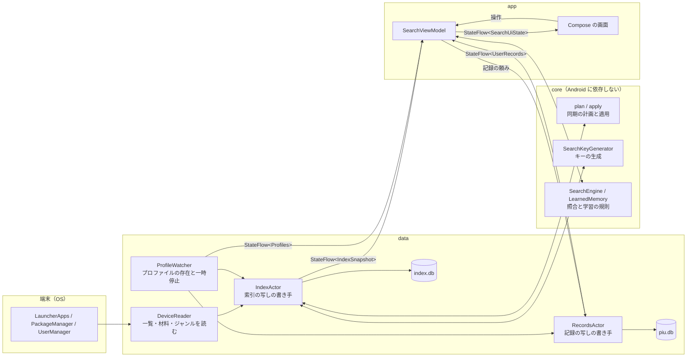
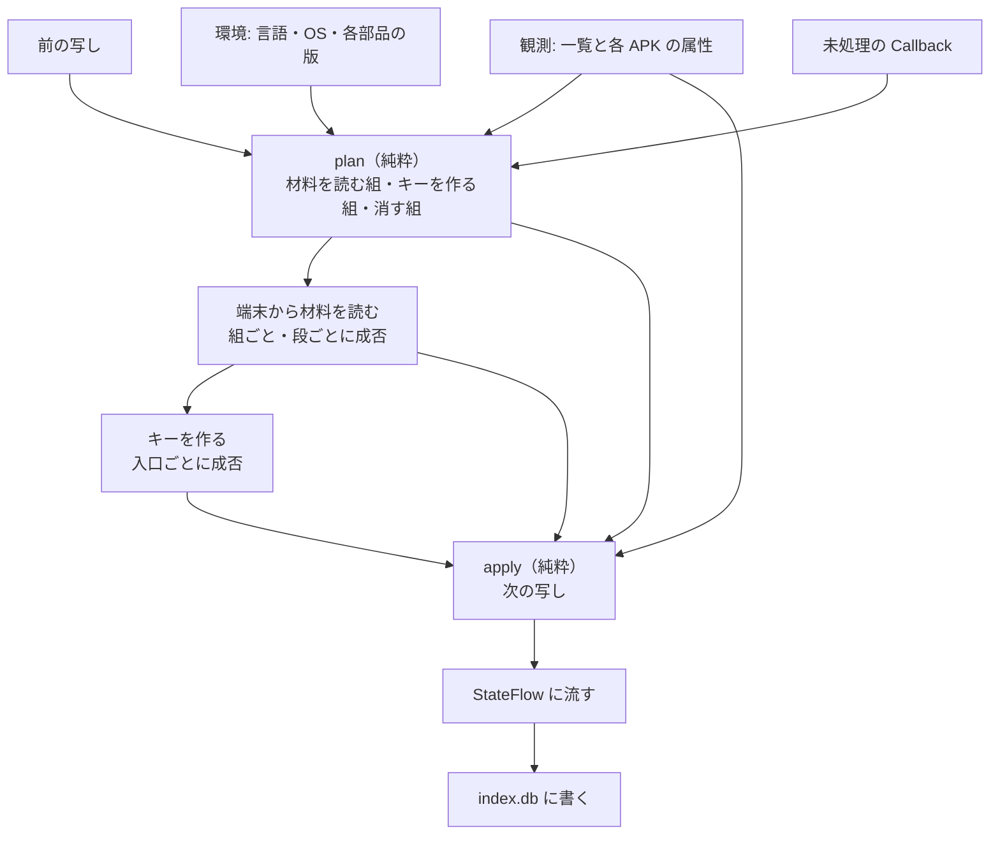

# v0.3 の設計

2026-11-18 の設計。まだ実装していない。0.2.0 の構成は [architecture.md](architecture.md) にあり、v0.3 の実装が終わるまではそちらが今のコードの説明になる。決定の一覧は [decisions.md](../decisions.md)、テストの計画は [testing.md](testing.md#v03-で足すテスト)。

## なぜ作り直すか

0.2.0 で直した不具合の多くは、同じ型をしていた。索引・学習・起動の記録の写しを、複数の部品が別々の時機に書き、それを照合・世代・再試行で守っていた。同期は「何を読み直すか」を 8 つほどの入力から決め、条件の組み合わせの漏れが不具合になった。

v0.3 では次の 2 つで、この型を構造から外す。

- 状態ごとに書き手を 1 つにする（actor）。画面は流れてくる写しを読むだけにする
- 同期を「鍵つきのメモ化」にする。何から作ったかの鍵を値と一緒に持ち、鍵が違うものだけを作り直す

保存の技術（Room）は変えない。複雑さの出どころは書き手の数と同期の条件で、SQLite ではないため。

## 用語

| 語 | 一行の定義 |
|---|---|
| 写し（スナップショット） | ある時点の状態をまとめた、作った後は変えないオブジェクト。変えるときは新しい写しを作って差し替える |
| coroutine | Kotlin の軽い並行処理の単位。「待つ」を関数の中に書け、途中で取り消せる |
| `StateFlow` | 最新の値を 1 つ持ち、購読した側に変化を配る流れ（kotlinx.coroutines の部品）。値が前と等しければ配らない |
| actor | 1 本の coroutine が `Channel`（頼みを順に受け取る列）から頼みを 1 つずつ処理し、ある状態の唯一の書き手になる作り。ロックの代わり |
| 組 | プロファイル（のシリアル番号）とパッケージ名の対。索引を作り直す単位 |
| 入口 | ランチャーに並ぶ Activity 1 つ。1 つの組に複数あることがある |
| 材料 | 組から読む、キーの元になる情報。表示名・別の言語の名前・署名の DN（提供元の名前） |
| キー | 照合に使う検索キー（読み・ローマ字など）。材料から形態素解析で作る |
| 欠け | ある組のある段（材料の読み取りやキーの生成）が失敗した事実。0.2.0 の `material_issue` と同じ |
| メモ化 | 計算の結果を入力の鍵と一緒に覚え、同じ鍵なら計算し直さないこと |
| 鍵 | メモ化で「何から作ったか」を表す値。鍵が今の環境から作った値と違えば作り直す |
| plan / apply | 同期の 2 つの純粋な関数（同じ入力なら同じ出力を返し、外の状態を変えない関数）。plan は何を読むかを決め、apply は読んだ結果から次の写しを作る |

## 何を変え、何を残すか

| | 0.2.0 | v0.3 |
|---|---|---|
| 状態の持ち主 | `IndexSync`・`LearningRepository`・`LaunchHistoryRepository`・`ProfileReconciler` などに分かれ、共通の書き手（`DatabaseWriter`）で順序をそろえる | 写しは 2 つ（索引・記録）。それぞれ 1 本の actor だけが差し替える |
| 同期 | 3 つの同期のモード、変更番号、作り直しの印（`rebuild_pending`）、`meta` の言語・OS | 鍵つきのメモ化。言語・OS・版は鍵に入る |
| 記録の保存 | Room の `piu.db`（索引と同じ DB） | Room の `piu.db`。記録の表だけにする（版 7） |
| 索引の保存 | 同上 | Room の新しい `index.db`。形が変われば捨てて作り直す |
| JSON | 学習の書き出しと読み込み | 変えない。保存には使わない |
| 画面 | `SearchController` と Activity が Listener で結び直す | `SearchViewModel` が写しの流れを組み合わせる |
| 件数の上限 | なし。180 日使わなければ忘れる（「出さない」の印は消さない） | 変えない |
| 照合・学習の規則・キーの生成・読み取りの部品 | — | 変えない（`core:*`、`AppSource` などの読み手） |

## 全体の形



| 部品 | 層 | 持つ状態 | 書き手 | 寿命・保存先 |
|---|---|---|---|---|
| `IndexActor` | data | `StateFlow<IndexSnapshot>`（組ごとの観測・材料・キー・欠け・ジャンル、プロファイルごとの一覧の状態）、未処理の Callback、未保存の印 | 自分だけ | プロセス。`index.db` |
| `RecordsActor` | data | 読み込みの状態と `UserRecords`（学習と起動の記録）、知っているプロファイル、救済の知らせと取り消し材料 | 自分だけ | プロセス。`piu.db`（知らせと取り消し材料はメモリだけ） |
| `ProfileWatcher` | data | `StateFlow<Profiles>`（存在するプロファイルのシリアル番号、仕事用の番号と一時停止） | 自分だけ | プロセス。保存しない |
| `SettingsStore` | app | `StateFlow<Settings>` | 設定の画面 | SharedPreferences（今のまま） |
| `SearchViewModel` | app | 検索語、タブ、全アプリの表示、セッション、起動中の印 | 自分だけ | ViewModel。回転で保つ。検索語だけ `SavedStateHandle` に残す |
| `SearchUiState` | app | 上の流れから作る、画面に出すものすべて | なし（計算の結果） | 画面が購読している間 |

0.2.0 との対応: `IndexSync`・`IndexStore`・`SyncPlanner`・`IndexLifecycle` は `IndexActor` と純粋な plan/apply に、`LearningRepository`・`LaunchHistoryRepository` とその保存の部品は `RecordsActor` に、`ProfileReconciler`・`ProfileLifecycle` は `ProfileWatcher` と `RecordsActor` の整理に、`SearchController` と Activity の接続は `SearchViewModel` になる。`DatabaseWriter`・`saveIfCurrent`・写しの `revision`・`LatestTask`・Listener の interface は要らなくなる。書き手が 1 つなら、計算している間に写しが他から変わらないため。

### actor の約束

- 頼みは届いた順に 1 つずつ処理する。処理の途中で中断（suspend。DB の書き込みを待つなど）しても、次の頼みはその処理が終わるまで始めない。順序は `Channel` を 1 本の coroutine で読むことで守り、単一スレッドの Dispatcher（coroutine を動かすスレッドの指定）には頼らない
- 各 DB を書くのは、その DB の actor だけ。2 つの DB をまたぐトランザクションは使わない
- 2 つの actor は互いの状態を触らない。プロファイルの削除は、両方が `ProfileWatcher` の確認を受けて、それぞれ自分の写しから落とす

### モジュール

`core:state` を新しく作り、写しの型と plan/apply、記録の操作を置く。Android に依存しないので JVM で速くテストできる。`data` は Room と KSP を持ち続ける。ほかのモジュールの分け方は [architecture.md](architecture.md#モジュール) と同じ。

## 索引: 鍵つきのメモ化

### 写しの形

索引の写しは、組ごとに 4 つの値を持つ。材料とキーには「何から作ったか」の鍵が付く。

```
PackageState（組 1 つ）
  observed   毎回読む（安い）
             entries     入口の Activity 名の集合
             archived    アーカイブ済みか
             apkKey?     base と split の APK のパス・時刻・大きさ。作れなければ null（失敗ではない）
             updatedAt?  個人用の PackageInfo.lastUpdateTime。apkKey が作れない組だけ問い合わせる
  materials  鍵が違うときだけ読む（高い: 資源と APK を開く）
             key         MaterialKey(apkKey, updatedAt, entriesHash, archived, locale, osBuild, readerVersion)
             generation  材料の世代
             bootCount?  材料を読んだときの再起動の回数
             labels・localized・signerDns
             issues      段ごとの欠けの事実（理由・最初と最後の日・retryOnce・書いた版）
  derived    鍵が違うときだけ作る（高い: 形態素解析）
             key         DerivedKey(materialsGeneration, generatorVersion, brandTableHash)
             keysByEntry 入口ごとのキー
             issue?      KEYS の欠け
  genres     毎回問い合わせる（APK によらず変わるため）
```

`entriesHash` は入口の集合から作る値、`readerVersion` は読み取りの部品の版、`generatorVersion` はキーの生成の規則の版（生成器を変えたときに上げる定数で、このアプリの版とは別）、`brandTableHash` はブランド表の中身から作る値。

### 同期の流れ



観測は一覧の時点の 1 回だけ。読んでいる間に APK が替われば、次の同期の観測で鍵が違い、そこで読み直す。

### plan の規則

| 対象 | 読み直す・作り直す条件（どれか 1 つ） |
|---|---|
| 材料 | まだない／`materials.key` が今の `MaterialKey` と違う／未処理の Callback がある／`retryOnce` の欠けの行がある／欠けの行を書いた版が今のこのアプリの版と違う／`apkKey` がなく、今の再起動の回数が `materials.bootCount` と違う（回数が取れなければ当たらない） |
| キー | まだない／`derived.key` が今の `DerivedKey` と違う（材料を読み直せば世代が進むので、必ずここに当たる）／`KEYS` の欠けが一時的で、まだ再試行していない／`KEYS` の欠けを書いた版が今のこのアプリの版と違う |
| 組の削除 | プロファイルの一覧が完全に取れていて、そこにない／プロファイルが存在しないと `ProfileWatcher` が確認した |

アーカイブ済みの組は、補助の材料（別の言語の名前・署名）を読まない。

### apply の規則

| 出来事 | 次の写し |
|---|---|
| 材料を読んだ（成否によらず） | `materials` を今の鍵で置き換え、世代を 1 進める。読めなかった段は前の値を保ち（なければ空）、欠けの行を書く。読めた段の行は消す。アーカイブ済みの組では、読まなかった補助の段の行を消す。`retryOnce` は、理由が一時的で、今回が再試行でなければ立てる |
| キーを作った（成否によらず） | `derived` を今の鍵で置き換える。作れなかった入口は前のキー、なければ表示名を正規化しただけのキー、それも無理ならキー 0 個。`KEYS` の欠けの行を書く |
| プロファイルの一覧が完全に取れた | その組の入口の集合を、今回の一覧の入口の集合にする |
| プロファイルが読めない | そのプロファイルの組は前の写しのまま保つ。鍵が古いまま残るので、読めるようになれば plan が拾う |

0.2.0 の作り直しの印・同期のモード・`meta` の言語と OS が要らなくなるのは、これらの変化がすべて鍵に入り、読めなかった組は古い鍵のまま残るため。

### 材料の世代

材料の世代は、組ごとに単調に増える数。材料を読むたびに、成否によらず 1 進める。キーの鍵は材料の鍵そのものではなく世代を持つ。

材料の鍵だけをキーの鍵に入れると、署名の読み取りが失敗した後に同じ APK のまま読めるようになったとき、材料の鍵は変わらず、提供元のキーが古いまま残る。世代にすれば、読み直した回は必ずキーも作り直す。

### 鍵のない組

`apkKey` が作れない組（APK の属性が読めない仕事用の組など）は、変化を鍵で拾えない。補うものは次のとおり。

- 再起動の回数（`Settings.Global.BOOT_COUNT`）: 同期のたびに今の回数を観測し、組ごとに材料を読んだときの回数（`materials.bootCount`）を持つ。鍵のない組は、今の回数がそれと違えば 1 回読み直す。読めば今の回数を持つので、起動 1 回につき 1 回で済む。回数が取れない端末では読み直さず、プロセスがない間の更新の取りこぼしは Callback に頼る
- 個人用の組は、`apkKey` が作れないときだけ `PackageInfo.lastUpdateTime` を問い合わせ、`updatedAt` として `MaterialKey` に入れる。`apkKey` がある組は問い合わせない
- Callback、入口の集合とアーカイブの状態（`MaterialKey` に入る）、OS と言語の変更

変化の検出は内容のハッシュではないので、同じパス・時刻・大きさのままの入れ替えは拾えない。この弱さは 0.2.0 と同じ。

### Callback

`LauncherApps.Callback`（パッケージの追加・変更・削除の知らせ）は、`IndexActor` への頼みとして順に届く。

- 知らせは（通知元の `UserHandle`・パッケージ名・番号）のまま持つ。番号は届いた順に増える数
- 組（シリアル番号）への解決は同期のときに行う。解決できなければ知らせを残す
- 同期は、開始時に「この番号までを対象にした」を覚える。終わったら、その番号以下で、かつその回で読んだか不在を確定した組の知らせだけを消す。同期中に届いた知らせと、読めないプロファイルの組の知らせは残る
- 同期の頼みは 1 つにまとめてよいが、知らせの対象は落とさない
- 検索画面が裏にある間は、知らせを溜めるだけで同期しない

0.2.0 の変更番号（`getChangedPackages`）による同期のモードはやめる。0.2.0 でもすでに毎回全入口の APK の属性を読んでおり、近道のための条件分岐のほうが高くついたため（計測の線を越えたときの使い方は[計測の計画](#計測の計画)）。

## 記録

### RecordsActor の状態

| 状態 | 意味 | 変更の頼みが来たら |
|---|---|---|
| `Loading` | 読み込み中 | 読み込みが終わるまで待つ |
| `Failed(理由)` | 読み込みに失敗した | 読み直す。また失敗したら、計算も書き込みもせずに失敗を返す |
| `Ready(UserRecords)` | 読めた | この写しから変更を計算する |

失敗を空の記録に置き換えない。空の写しから計算して保存すると、保存済みの記録を上書きするため。`Failed` からは、次の頼みと検索画面の前面への復帰で読み直す（0.2.0 の `ensureLoaded` と同じ規則）。

学習と起動の記録は、1 つのトランザクションで読み、1 つの写し `UserRecords` にする。

### 頼みと書き込み

頼みは、選んだ・起動した・抑制・取り消し・削除・全消去・ファイルの読み込み・忘却・プロファイルの整理。`RecordsActor` は 1 つずつ、次の順で処理する。

1. `Ready` の写しから変更を計算する（`LearnedMemory` の純粋な操作と、起動の記録の操作）
2. 1 つのトランザクションで `piu.db` に書く
3. 書けたら写しを公開し、救済の知らせと取り消し材料を更新して成功を返す。書けなければ写しを変えずに失敗を返す

アプリを開くときの学習と起動の記録は、1 つの頼み・1 つのトランザクションにする。0.2.0 の「片方だけ成功することもある」はなくなる。

### 知っているプロファイルと整理

`RecordsActor` は `ProfileWatcher` から確認済みのプロファイルを受け取り、次を分けて持つ。

- 最後に確認した集合（まだ確認できていなければ「分からない」。空の集合とは区別する）
- 削除済みの番号
- 終わっていない整理（記録から消すべき番号）

規則:

- 「分からない」間は、削除も書き込みの拒否もしない
- 削除済みの番号への書き込みは拒む。削除より前に作った取り消し材料も無効にする
- 整理（その番号の学習と起動の記録を消すトランザクション）に失敗したら、集合の変化を待たず、次の頼みと前面への復帰で再試行する。`StateFlow` は同じ値を配らないので、集合の通知だけに頼ると再試行の機会がない
- 問い合わせが失敗しても、確認済みの削除を忘れない
- 最後に確認した集合にない新しい番号を、すぐに削除済みとはみなさない（新しいプロファイルかもしれないので再確認する）

削除と決める条件（有効な一覧で存在しないと確認できたときだけ）は [architecture.md](architecture.md#削除の確認) と同じ。

### InstallationGuard

端末間の転送を見分ける印（`noBackupFilesDir` の乱数と `installation` の表の印）の照合を、記録の DB 専用に作り直す。0.2.0 の照合は索引の表も消していたが、版 7 にはその表がない。

- `RecordsActor` が最初の読み込みの前に行う
- 印が違えば、1 つのトランザクションで、このアプリが動いているユーザー以外の番号の `learned`・`launch_stat` を消し、印を更新する
- 印のファイルが壊れている・読めない場合の扱いは 0.2.0 と同じ

### 端末間の転送

端末間の転送（D2D）の対象は `piu.db` と設定だけ。`index.db` は転送しない（受け取った側で作り直す）。クラウドへの自動バックアップは、0.2.0 と同じくすべて外す。

## 保存

### 2 つの DB

| DB | 中身 | 消えてよいか | 形が変わったら |
|---|---|---|---|
| `piu.db`（Room の版 7） | `learned`・`launch_stat`・`installation` | よくない（利用者の記録） | Room の移行を書く |
| `index.db`（Room） | 索引の写し（組ごとの観測・材料と世代・キー・欠け・ジャンル、プロファイルの一覧の状態） | よい | 捨てて作り直す（`fallbackToDestructiveMigration`） |

分けたのは、索引の形を変えるたびに記録の DB の移行を書かないため。索引の DB は「形が変われば捨てる」を Room の設定 1 つで宣言できる。起動時に `index.db` が読めなければ、空から全件を作り直す。

### 公開と保存の順序

| 写し | 順序 | 理由 |
|---|---|---|
| 記録 | DB に書けたら公開する | 記録は利用者の意思。画面に出したものが保存されていない状態を作らない |
| 索引 | 公開してから DB に書く | 索引は消えてよい。保存を待たずに検索に使える |

### 未保存の印

`IndexActor` は「未保存の印」を持つ。保存に失敗したら印を立てたままにし、内容が変わらなくても次の同期で書き直す。

- 印が立っていれば、今の写しを丸ごと 1 つのトランザクションで書く。材料・世代・キー・欠けを一緒に確定する
- 部分の更新をするなら、差分は「最後に保存できた写し」との差分で取る。直前に公開した写しとの差分では、失敗した回の変更が DB に入らないまま印が下りる。初版は丸ごとでよい
- 成功したときだけ印を下ろす

### 移行（Room 6 → 7）

`piu.db` の移行は 1 本だけ。`learned`・`launch_stat`・`installation` を残し、索引の表（`app`・`search_key`・`meta`・`material_issue`）を落とす。落とした索引は、最初の同期の全件の作り直しで戻る。

移行は Room のトランザクションの中で行うので、途中で終了しても版 6 のまま残り、次に開くときにまた試す。v0.2 からのデータの引き継ぎは必須ではないが、DB のままなら移行は小さく、記録は残せる。

## 画面

### SearchViewModel

索引・記録・プロファイル・設定の 4 つの `StateFlow` と、自分の持つ検索語・タブ・全アプリの表示を組み合わせて `SearchUiState` を作る。Activity は描画と、OS の画面（アプリ情報・設定）を開く操作だけを持つ。`onStart`/`onStop` での Listener の登録と解除はなくなる。設定も `SettingsStore` の流れで受けるので、`onResume` で読み直さない。

### 2 段の検索

入力から結果までは 0.2.0 と同じく 2 段にする。

1. 表記での照合をすぐに出す
2. 漢字の検索語の読みを後から付け、補った結果で出し直す

読みの結果は、どの検索語と、どの索引の写しに対して作ったものかを確かめてから当てる。どちらかが変わっていれば捨てる。

### 派生の索引

派生の索引（学習を重ね、プロファイルで絞った検索の材料）は、学習・起動の記録・同期の状態を別々の入力にする。起動の記録だけが変わったときは、学習の重ねを作り直さず、順位の信号だけを更新する（0.2.0 と同じ最適化）。

### アプリを開く流れと寿命

0.2.0 の `AppLauncher` の規則を ViewModel に移し、次の規則をテストで残す。

- 選んだ時点で、表示名・時刻・学習の判断を固定してセッションを終える
- 一時停止中の仕事用アプリへの要求は、学習にも起動の記録にも数えない（`PreparedLaunch.recordsChoice`）。OS の再開の確認画面で利用者が取り消したかどうかは、アプリから分からないため
- 受理した起動（記録の保存 → 写しの公開 → OS への起動の要求）は、ViewModel の寿命から切り離したアプリの寿命の scope（coroutine を取り消す単位）で最後まで行う。画面が閉じても、受理した起動は続ける
- 記録の保存に失敗してもアプリは開く。救済の Toast は、保存の成功と OS の受付の両方の後にだけ出す
- 起動に失敗したら「開いている」の印を解く
- 操作とセッションの番号で、古い完了が新しい画面（回転・呼び直しの後）を閉じないようにする

利用者への失敗の知らせ方（Toast・Snackbar・検索画面の 1 行・索引の状態）は 0.2.0 と同じ（[ui.md](ui.md)）。

## 法則

ランダムな観測の列で確かめる性質（property-based test）。

1. **収束**: 未消費の再試行の印（`retryOnce` と `KEYS` の再試行）がなく、新しい無効化（Callback）もなければ、同じ端末の状態での 2 回目の同期は材料もキーも読まない。再試行でも失敗した組は印が下り、その後は読まない
2. **一覧の入口は必ず索引に入る**: 一覧が完全に取れたプロファイルでは、apply の後の入口の集合が観測の入口の集合と等しい
3. **読めないプロファイルの組は前の写しのまま**: 一覧が取れないプロファイルの組は、apply の前後で同じ
4. **鍵は成否によらず今の値**: 読んだ組の `materials.key` と `derived.key` は、失敗しても今の環境から作った鍵と等しい
5. **回復**: 材料が読めるようになれば、その回でキーも作り直され、検索の結果に反映される。安定して読める状態では、全件を作り直した結果と一致する
6. **記録は、DB に書けたときだけ変わる**: 書き込みに失敗した頼みは、写しも DB も変えない

## 受入の場面

法則に加え、次の場面を v0.3 の受入の条件にする。

索引:

- 停止 → 言語・OS・このアプリの更新 → 再開
- 入口の変更（APK は同じ）／アーカイブ → 復元
- 同期中に届いた Callback が、その同期で消えない
- 通知元のシリアル番号が解決できない Callback が残り、解決できた同期で読まれる
- 読めないプロファイルの組の Callback が、同期の後も残る
- 材料の回復（署名が読めるようになる → 提供元のキーが直る）／`KEYS` だけの回復
- 索引の保存の失敗 → 同じ入力で再試行 → 開き直して同じ写しが戻る

記録:

- 読み込みの失敗の間に選んだ・抑制した: 空の写しから書かず、失敗を返す。次の頼みで読み直す
- 記録の保存の失敗: 写しが変わらない
- プロファイルの削除の後の、遅い記録と古い取り消し: 拒まれる
- プロファイルの整理の失敗 → 集合が変わらないまま、次の頼み・前面への復帰で再試行される
- InstallationGuard: 新規のインストール・0.3 どうしの転送・同じ端末の更新

保存と移行:

- 移行 6 → 7 の途中での終了: 版 6 に戻り、次に開くと移行が終わる
- 0.2 のバックアップを 0.3 の規則で復元する: 記録が残り、索引は作り直される

画面:

- 起動の流れの回転・呼び直し・画面の終了（受理した起動が続く・古い完了が新しい画面を閉じない）
- 一時停止中の仕事用アプリ: OS が要求を受け付けても記録しない

## 捨てた案と理由

| 案 | 捨てた理由 |
|---|---|
| 記録を JSON のファイルにして丸ごと書く（`AtomicFile`） | 保存の成功の判定・途中での終了からの回復・端末間の転送・旧 DB からの移行を自作することになる。Android 9 の `AtomicFile` は初回の書き込みで本体に直接書くなど、戻り値だけで成功を判定できない場合がある。記録は利用者の意思なので、トランザクションと移行の仕組みを持つ SQLite に残す |
| 記録も索引も 1 つの DB | 索引の形を変えるたびに記録の DB の移行が要る。分ければ、索引の DB は「捨てて作り直す」と宣言できる |
| 索引を JSON のファイルにする | 可能だが、Room の DB にしても費用は小さい。書き込みの失敗を例外で確実に知れ、保存の部品が 1 種類で済む |
| 保存の形と書き出しの形を同じ JSON にする | 書き出しは持ち出し用の変換で、保存とは目的が違う。書き出しと読み込みは今の形のまま残す |
| 件数の上限で古い記録を忘れる | 「この語では出さない」の印まで消してしまう。今の 180 日の忘却で足りる |
| 変更番号（`getChangedPackages`）で同期のモードを分ける | 毎回の全件の観測はすでに行っており、近道の条件分岐が不具合のもとになった。費用は計測で確かめる |

## 計測の計画

| いつ | 何を | どこで | 線 |
|---|---|---|---|
| M8-01b（0.2.0 のまま） | 一覧と観測の時間、個人用の `lastUpdateTime` の問い合わせの費用、索引の DB の読み込み | 実機とエミュレータ | いちばん遅い端末で、一覧と観測が 100 ms |
| M8-02b（新しい実装） | 起動から検索できるまで、タップから OS への起動の要求まで、変更なしの同期 | 実機とエミュレータ | 0.2.0 と比べる |
| M8-04（差し替え） | 起動の速さ（`:benchmark` の前後）、Baseline Profile の作り直し | エミュレータ | 0.2.0 と比べる |

一覧と観測が線を越えたら、`DeviceReader` の中で変更番号（`getChangedPackages`）を、APK の属性の読み取り（stat）を省いてよい個人用の組を選ぶ手がかりとして使う。省いた組は前の観測の値を返す。観測の結果の形と plan/apply は変えないので、法則と受入の場面はそのまま効く。

段階の途中では、debug 版にだけ 0.2.0 の同期を残し、2 つの同期の結果（入口・キー・欠け）を実機で突き合わせる。製品には新旧の同期を並べない。記録は表の形を変えないので、比べるのは索引だけ。
